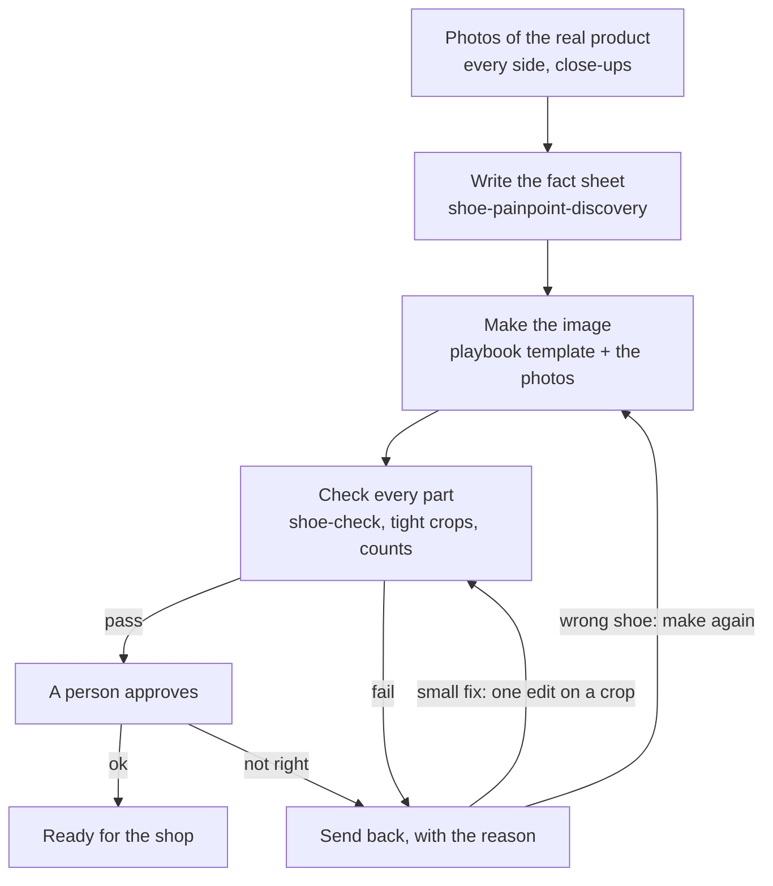

# shop-skills

Small skills that help shops catch mistakes in AI product images.
Each skill is a short checklist plus a prompt you can copy. No code needed.

**Start here: the [Shoe playbook](PLAYBOOK.md)**, a prompt template and a check for 9 shoe types.

## Skills

| Skill | What it does |
|---|---|
| [shoe-painpoint-discovery](skills/shoe-painpoint-discovery/) | Turns photos of your real shoe into its fact sheet, the parts AI usually breaks and a prompt snippet. |
| [shoe-check](skills/shoe-check/) | Checks an AI shoe image against the real shoe: logos, counts, badge text, pair and ground. |

## How to use a skill

- **Paste the prompt:** open the skill's `SKILL.md`, attach your images to any AI chat that reads images and paste the prompt.
- **Add it to Claude:** copy the skill's folder into your Claude skills. It loads when you ask for that task.

Every skill's README says how it was tested and what it missed.

## License

MIT, see [LICENSE](LICENSE).

## One check of many

These skills are one manual check. Getting a product image right takes many: logos per side, counts, text, pattern, colour, pair, contact with the ground. Each one breaks in its own way and each one needs its own test.

In our own QA every image runs through the same loop. Software checks each part on a tight crop next to the real product photo and counts without guessing. Then a person approves every image before it goes out, because software misses things: on our own campaign shoot, a person caught a logo on the inner side of a shoe that the check had passed.

How each step maps to this repo: the fact sheet is [shoe-painpoint-discovery](skills/shoe-painpoint-discovery/), the templates are in the [Shoe playbook](PLAYBOOK.md), the check is [shoe-check](skills/shoe-check/).

Checking a whole catalogue? We set this up for shops, including fixing the images. [Book a 30 minute call](https://calendly.com/longinteger/30min) or see [longlabs.tech](https://longlabs.tech).

by Long//Labs
