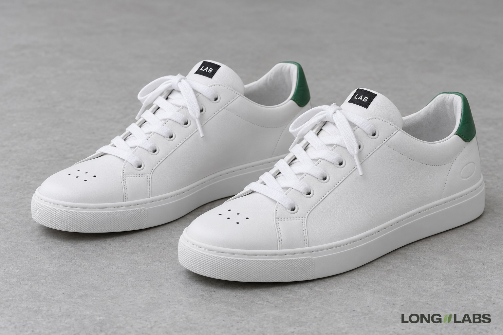

# Lace-up sneaker



## Template

Attach photos of the real shoe from every side plus close-ups, then fill in the brackets.

```
The reference photos show the [sneaker] from every side plus close-ups of every detail. Copy it exactly, do not redesign:
1. [Main logo]: [colour, size], on the outer side of the [part], [above or below which part]. The inner side has none, so seen side by side only one shoe shows it. Nowhere else.
2. [Tongue badge or label]: on the top of the tongue, reading [EXACT TEXT]. Not on [the side or the heel].
3. [Heel tab or pull tab]: [how many], [flat or loop], [colour], at [where].
4. Lace stations: exactly [number] eyelets per side, the first just behind [the toe cap], the last at [the collar].
5. [Holes or perforations]: exactly [number] in [rows], on [which panel].
6. A left shoe and a right shoe, mirror images.
No extra logos, no stripes, no changed colours.
```

## Filled test version

An invented shoe, text only (no reference photos), so the first line becomes "A product photo of ...".

```
A product photo of a pair of white leather low-top sneakers on a light grey floor in soft studio light. Both shoes stand side by side, seen from the outer side of the near shoe at a slight three-quarter angle from the front. Copy this design exactly, do not redesign:
1. Logo: a small embossed oval, white on white, on the outer side of the heel counter only, just below the collar. The inner side of each shoe has no logo, so seen side by side only one shoe shows it.
2. Tongue badge: a small black woven label stitched to the top of the tongue, reading LAB in white capitals. Not on the side, not on the heel.
3. Heel tab: one flat green leather tab at the back of the collar, stitched flat, no loop.
4. Lace stations: exactly 5 eyelet holes per side, the first just behind the toe cap, the fifth at the top by the collar. Flat white laces tied in a bow.
5. Toe perforations: exactly 6 small round holes on the toe cap, in 2 rows of 3.
6. A left shoe and a right shoe, mirror images, toes pointing slightly outward.
No extra logos, no stripes, no changed colours.
```

## Test result

Round 1: the logo showed on the visible side of both shoes, so it was on an inner side too (2 of 2). The eyelets of round 1 were not counted a second time.
After one change to line 1 ("the inner side has none, so only one shoe shows it"): the logo held on 2 of 2 images.
But a recount on numbered crops found 6 eyelets per side on both images, not the 5 the prompt asked for (the first check had passed it). The 6 toe holes in 2 rows of 3 held.
So this template is not passed yet: count the eyelets by eye on every image and fix them on a crop when they are off.

**Status:** Not passed yet: the logo fix held, but 6 eyelets came out instead of 5 on both images.
