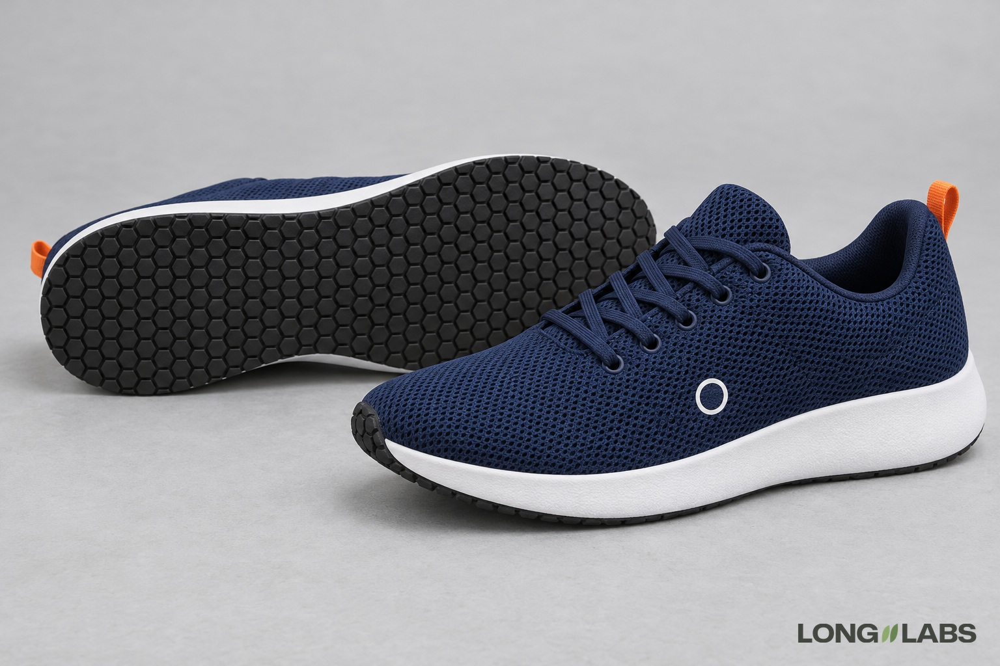

# Running shoe



## Template

Attach photos of the real shoe from every side plus close-ups, then fill in the brackets.

```
The reference photos show the [running shoe] from every side plus close-ups of every detail. Copy it exactly, do not redesign:
1. Upper: [mesh or knit], [colour], with a visible [weave or knit texture] across [which panels]. Matte fabric, not plastic, no shine.
2. [Main logo]: [colour, size], on the outer side of the [part], just above the midsole. Nowhere else.
3. Outsole: [rubber colour] with [tread pattern], every lug the same size, the pattern running to the edge of the sole. No swirls, no blurred tread.
4. Midsole: [foam colour], [thicker at the heel than at the toe], with one clean line where it meets the upper.
5. Lace stations: exactly [number] eyelets per side, [lace type].
6. [Heel loop or tab]: [how many], [colour], at [where]. No other [colour].
7. A left shoe and a right shoe, mirror images.
No extra logos, no changed colours.
```

## Filled test version

An invented shoe, text only (no reference photos), so the first line becomes "A product photo of ...".

```
A product photo of a pair of navy running shoes on a light grey floor in soft studio light. The right shoe stands upright, its outer side facing the camera. The left shoe lies on its outer side behind it, so its full outsole faces the camera. Copy this design exactly, do not redesign:
1. Upper: navy engineered mesh with a visible small open weave across the whole upper. Matte fabric, not plastic, no shine.
2. Logo: one small white printed circle on the outer side of the midfoot, just above the midsole. Nowhere else.
3. Outsole: black rubber with a regular grid of small hexagon lugs, every lug the same size, the pattern running to the edge of the sole. No swirls, no blurred tread.
4. Midsole: white foam, thicker at the heel than at the toe, with one clean line where it meets the upper.
5. Lace stations: exactly 5 eyelet holes per side, round navy laces.
6. Heel: one small orange fabric pull loop at the top of the heel. No other orange.
7. A left shoe and a right shoe, mirror images.
No extra logos, no stripes, no changed colours.
```

## Test result

Passed 1 of 2 images. The tread, the mesh and the midsole held on both.
Image 2 failed two points. It had a second logo on the inner side of the lying shoe. It also had 6 eyelets instead of 5.
No point failed on both images, so no fix round. Untested idea: the sneaker fix for line 2 ("the inner side has none").

**Status:** One of 2 images failed: an extra logo and 6 eyelets instead of 5.
