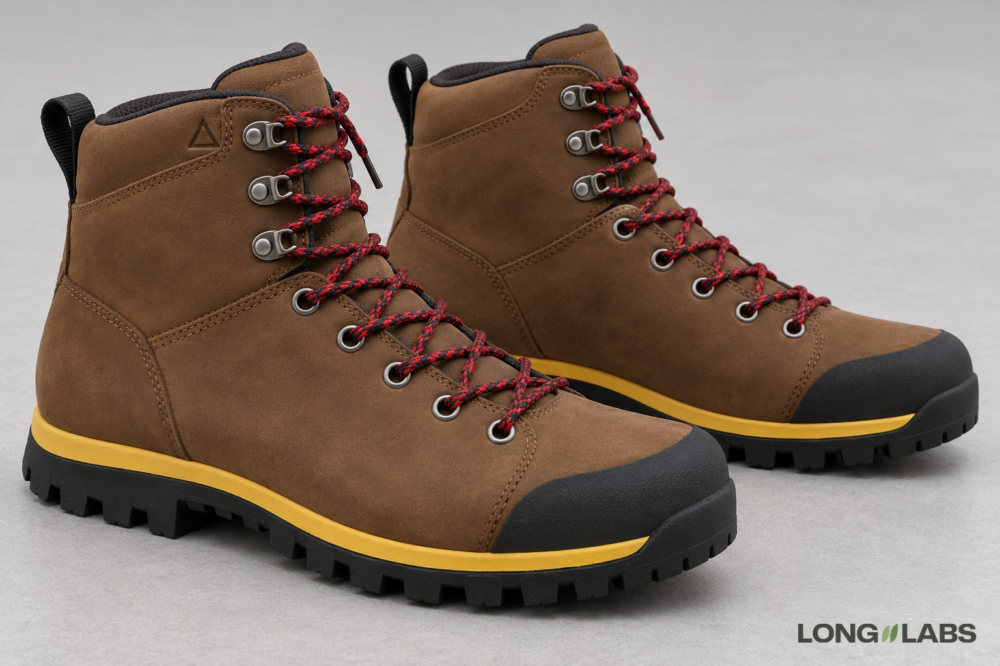

# Hiking or work boot



## Template

Attach photos of the real shoe from every side plus close-ups, then fill in the brackets.

```
The reference photos show the [boot] from every side plus close-ups of every detail. Copy it exactly, do not redesign:
1. Lacing: [number] round eyelets low on the boot, then [number] open metal speed hooks at the ankle. [Lace colour and type] cross between each pair and wrap around each hook, both ends in [aglets]. Count them: [number] eyelets, [number] hooks per side.
2. [Logo]: [what, size], on the outer side of the [collar], [anchored to the hooks or a seam]. Nowhere else, not on the tongue.
3. Toe: [toe bumper or rand], wraps the front of the toe and stops before the first eyelet.
4. Heel: [how many] [pull loop], [colour], at the top of the heel.
5. Sole: [lug shape], [edge lugs], a [colour] midsole band between sole and upper.
6. A left boot and a right boot, mirror images.
No extra logos, no changed colours.
```

## Filled test version

An invented shoe, text only (no reference photos), so the first line becomes "A product photo of ...".

```
A product photo of a pair of brown nubuck hiking boots on a light grey floor in soft studio light. Both boots stand side by side, seen from the outer side of the near boot at a slight three-quarter angle from the front. Copy this design exactly, do not redesign:
1. Lacing: five round eyelets low on the boot, then three open metal speed hooks at the ankle. Round red and black laces cross between each pair and wrap around each hook, both lace ends finish in plastic aglets. Count them: five eyelets, three hooks per side.
2. Logo: one small embossed triangle on the outer side of the collar, directly above the top speed hook, between the hook and the top edge. The inner side has no logo, so seen side by side only one boot shows it. Not on the tongue.
3. Toe: a black rubber toe bumper that wraps the front of the toe and stops before the first eyelet.
4. Heel: one black fabric pull loop at the top of the heel. One only.
5. Sole: black rubber with deep square lugs, a row of square lugs along the edge, a yellow midsole band between sole and upper.
6. A left boot and a right boot, mirror images.
No extra logos, no changed colours.
```

## Test result

Did not pass. Lacing (5 eyelets, 3 hooks) was exact on 3 of 4 images; one image had 4 eyelets.
The logo never sat where we asked: it lands beside the top hook, toward the heel, on all 4 images. The one change ("directly above the top hook, outer side only") put it on one boot only, but not above the hook.
Use the lacing line as is. Place a logo where your boot really has it and check it by eye, or fix it with an edit on a crop.

**Status:** Not passed yet: the logo landed beside the top hook on 4 of 4 images. Lacing held on 3 of 4.
