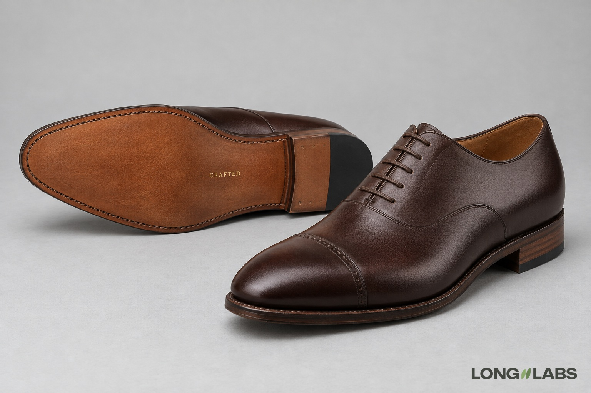

# Dress shoe



## Template

Attach photos of the real shoe from every side plus close-ups, then fill in the brackets.

```
The reference photos show the [shoe] from every side plus close-ups of every detail. Copy it exactly, do not redesign:
1. Lace stations: exactly [number] lace holes per side, [closed or open] lacing, [lace type] in [straight bars or criss-cross]. Count only holes a lace goes through.
2. Toe cap: [straight cap, wingtip or plain], with [perforation pattern] along [which seam]. [No medallion, no wingtip].
3. Sole text: [EXACT TEXT] stamped in [colour, size] on [where on the sole]. No other text on the sole.
4. Heel: [stacked leather or block], [visible layers], [top piece colour].
5. Welt: [one row of stitching] around the edge of the sole.
6. A left shoe and a right shoe, mirror images.
No logos on the upper, no changed colours.
```

## Filled test version

An invented shoe, text only (no reference photos), so the first line becomes "A product photo of ...".

```
A product photo of a pair of dark brown leather oxford dress shoes on a light grey floor in soft studio light. The right shoe stands upright, its outer side facing the camera at a slight angle from the front. The left shoe lies on its side behind it, so its leather sole faces the camera. Copy this design exactly, do not redesign:
1. Lace stations: exactly 5 lace holes per side, closed lacing (the two sides meet under the laces), thin waxed brown laces in straight bars.
2. Toe cap: a straight toe cap seam with one single row of small punched holes along it. The toe cap below the seam is plain, no medallion, no wingtip.
3. Sole text: the word CRAFTED stamped in small gold capitals in the middle of the sole, between the ball and the heel. No other text on the sole.
4. Heel: a stacked leather heel with visible layers, a black rubber top piece.
5. Stitching: one row of welt stitching running around the edge of the sole.
6. A left shoe and a right shoe, mirror images.
No logos on the upper, no changed colours.
```

## Test result

Passed 1 of 2 images. Sole text, toe cap perforation, heel and welt held on both; the stamped word read right on both.
Image 1 had 6 lace holes per side instead of 5.
The pair was unsure on both (one shoe lies on its side to show the sole). No point failed on both, so no fix round.

**Status:** One of 2 images failed: 6 lace holes instead of 5. The sole text held on 2 of 2.
