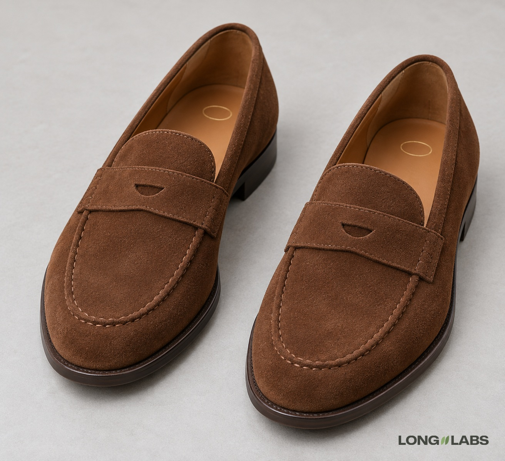

# Loafer or slip-on



## Template

Attach photos of the real shoe from every side plus close-ups, then fill in the brackets.

```
The reference photos show the [loafer] from every side plus close-ups of every detail. Copy it exactly, do not redesign:
1. [Strap, bit or tassels]: [how many], [shape of any cut-out], across [which part], fixed at [where].
2. Apron: [raised hand stitching or flat seam], [single or double row] around the top of the toe.
3. Material: [matte suede with a brushed nap, or polished leather], no shine anywhere. [The strap is the same material.]
4. [Insole stamp]: [colour, shape] on the heel of the insole. Nowhere else.
5. No [the hardware it does not have: tassels, metal bit, bow, buckle].
6. Pair: a left shoe and a right shoe, mirror images of each other, toes pointing slightly outward, the [strap] and the [apron] identical on both. Each shoe curves toward its own big toe side. No two left shoes.
No logos on the outside, no changed colours.
```

## Filled test version

An invented shoe, text only (no reference photos), so the first line becomes "A product photo of ...".

```
A product photo of a pair of tobacco brown suede penny loafers on a light grey floor in soft studio light. Both shoes stand side by side, seen from the front at a three-quarter angle from above. Copy this design exactly, do not redesign:
1. Penny strap: one leather strap across the top of the foot with one small half moon cut-out in the middle, stitched at both ends to the sides of the apron.
2. Apron: one raised row of hand stitching around the top of the toe. Single row, no second row.
3. Material: matte suede with a soft brushed nap, no shine anywhere. The strap is the same suede.
4. Insole: a small gold-stamped oval on the heel of the insole. Nowhere else.
5. No tassels, no metal bit, no bow, no buckle.
6. Pair: a left shoe and a right shoe, mirror images of each other, toes pointing slightly outward, the penny strap and the stitched apron identical on both. Each shoe curves toward its own big toe side. No two left shoes.
No logos on the outside, no changed colours.
```

## Test result

Passed 1 of 2 images. Pair, suede, apron stitching, insole stamp and "no hardware" held on both.
Image 1 cut the strap opening as a thin almond slit instead of a half moon.
No point failed on both, so no fix round. Describe the cut-out shape and check it on a crop.

**Status:** One of 2 images failed: the strap cut-out came out almond shaped, not a half moon.
