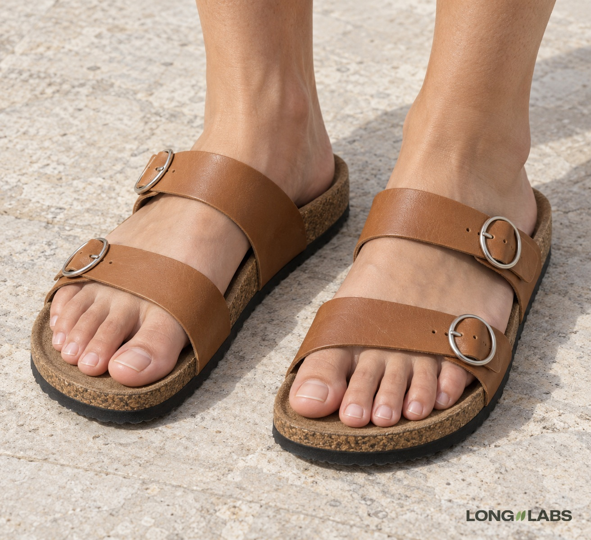

# Sandal or slide



## Template

Attach photos of the real shoe from every side plus close-ups, then fill in the brackets.

```
The reference photos show the [sandal] from every side plus close-ups of every detail. Copy it exactly, do not redesign:
1. Straps: exactly [number] [width, material] straps across each foot, [one over the toes, one over the instep], pressing gently into the skin. No straps passing through skin.
2. [Buckles]: one [size, shape, colour] buckle on each strap, on the outer side of the foot. [Number] buckles per shoe. Not [the shape AI drifts to].
3. Footbed: [material, texture, top layer].
4. Sole: [colour, thickness].
5. Toes: five toes on each foot, natural length, the big toe longest, nails trimmed. No extra toes, no toes fused together, every toe resting on the footbed.
6. A left foot in a left [sandal] and a right foot in a right [sandal], mirror images.
No logos, no changed colours.
```

## Filled test version

An invented shoe, text only (no reference photos), so the first line becomes "A product photo of ...".

```
A product photo of two bare feet wearing a pair of tan leather slides, standing on a light stone floor in soft daylight, seen from the front at a slight angle from above. Copy this design exactly, do not redesign:
1. Straps: exactly two wide flat tan leather straps across each foot, one over the toes and one over the instep, pressing gently into the skin. No straps passing through skin.
2. Buckles: one small silver ring buckle on each strap, a perfect circle about the size of a fingernail, on the outer side of the foot. Two buckles per shoe. Not oval, not square.
3. Footbed: a contoured cork footbed with visible cork grain and a thin suede top layer.
4. Sole: a black rubber sole under the cork, thin and flat.
5. Toes: five toes on each foot, natural length, the big toe longest, nails trimmed. No extra toes, no toes fused together, every toe resting on the footbed.
6. A left foot in a left slide and a right foot in a right slide, mirror images.
No logos, no changed colours.
```

## Test result

Round 1: toes (5 per foot), straps, footbed and pair held on both; the buckles came out oval or square instead of round (2 of 2).
After one change to line 2 ("a perfect circle, not oval, not square"): passed 2 of 2 images, all 6 points.
Toes were counted one by one on every foot. Count them again on every new image.

**Status:** Passed 2 of 2 after one fix: round buckles, 2 straps, 5 toes on every foot.
