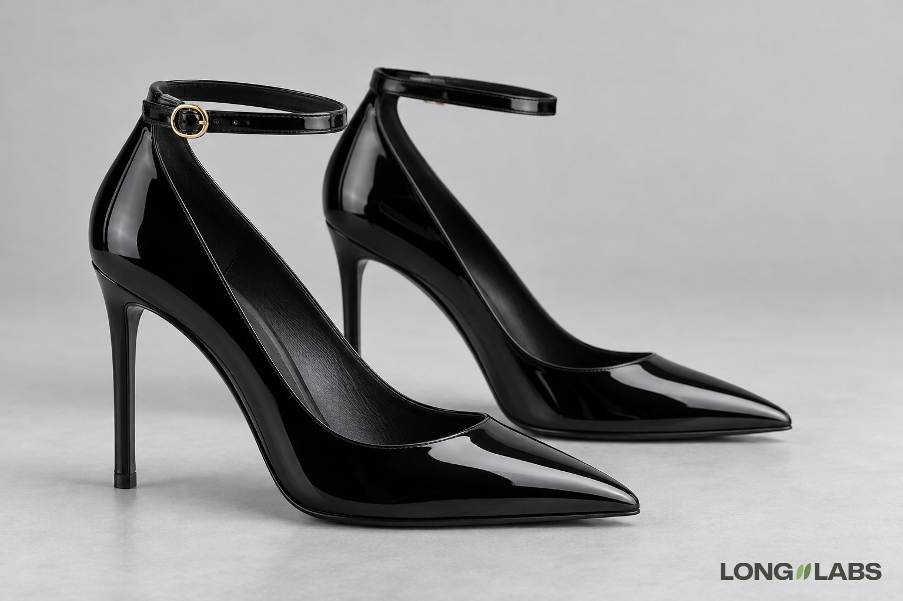

# Heel or pump



## Template

Attach photos of the real shoe from every side plus close-ups, then fill in the brackets.

```
The reference photos show the [shoe] from every side plus close-ups of every detail. Copy it exactly, do not redesign:
1. Heel: [stiletto, block or kitten], about [height] cm, set under the centre of the heel cup, [top piece colour]. Not [the shape it must not be].
2. Contact: the shoe stands on the floor with a soft shadow under the toe and a small sharp shadow under the heel tip. Not floating, no shadow missing.
3. Toe: [closed pointed, round, square or open].
4. [Strap and buckle]: [how many] [colour] strap around the ankle with one [size, shape, colour] buckle on the outer side of the ankle.
5. Material: [patent, suede or leather] [how it takes light].
6. A left shoe and a right shoe, mirror images, each buckle on its own outer side.
No logos, no other metal, no changed colours.
```

## Filled test version

An invented shoe, text only (no reference photos), so the first line becomes "A product photo of ...".

```
A product photo of a pair of black patent leather pumps on a light grey floor in soft studio light. Both shoes stand side by side, seen from the outer side of the near shoe. Copy this design exactly, do not redesign:
1. Heel: a thin straight stiletto heel about 9 cm high, set under the centre of the heel cup, with a small black top piece. Not curved, not a block.
2. Contact: the shoe stands on the floor with a soft shadow under the toe and a small sharp shadow under the heel tip. Not floating, no shadow missing.
3. Toe: a closed pointed toe.
4. Ankle strap: one thin black strap around the ankle with one small round gold buckle on the outer side of the ankle.
5. Material: patent leather that mirrors the floor and window light in clean curved highlights.
6. A left shoe and a right shoe, mirror images, each buckle on its own outer side.
No logos, no other metal, no changed colours.
```

## Test result

Heel shape, ground contact, toe, buckle and patent held on 2 of 2 images.
Image 1 added faint gold lettering on the insole although the prompt said no logos. Image 2 had no fail; the far buckle was too blurred to place (unsure).
So 1 of 2 images had no fail (with one point unsure). If the insole matters, add a line for it ("plain insole, no print"), not tested.

**Status:** One of 2 images failed: a print on the insole that the prompt said not to add.
