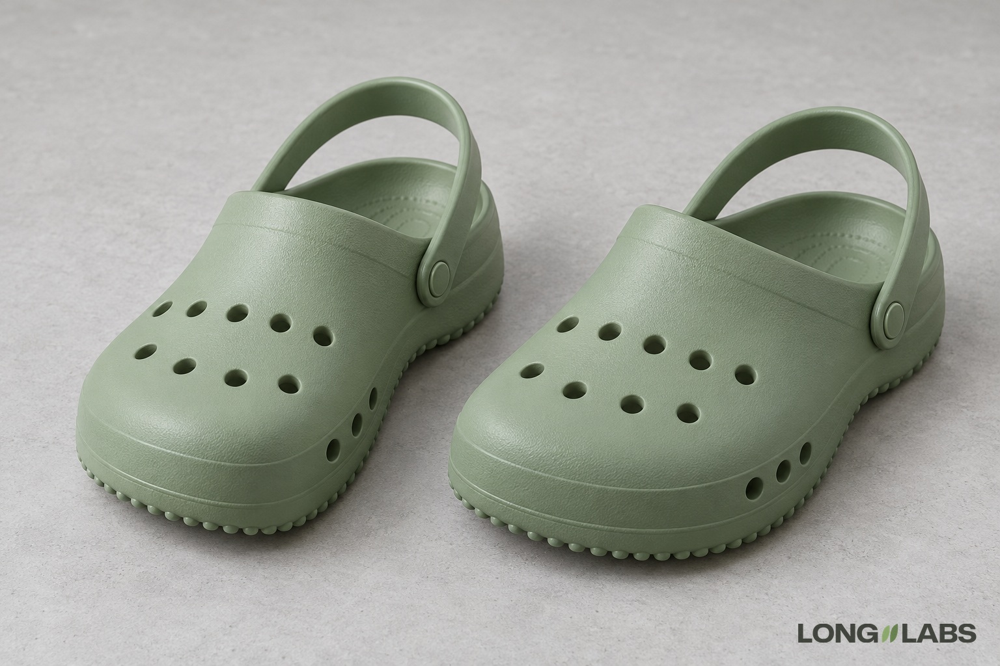

# Clog or mule



## Template

Attach photos of the real shoe from every side plus close-ups, then fill in the brackets.

```
The reference photos show the [clog] from every side plus close-ups of every detail. Copy it exactly, do not redesign:
1. Top holes: round holes in exactly [number] rows across the top of the toe: [number] in the front row, [number] in the back row. No other holes on top.
2. Side holes: exactly [number] holes in one row on each side, [anchored to the sole or toe].
3. Heel strap: one [strap], fixed on each side by one [rivet or hinge], [anchored to another part].
4. [Rivet or hinge detail]: [what it shows]. Same on both sides.
5. Sole: [tread or edge detail].
6. A left [clog] and a right [clog], mirror images.
No logos, no changed colours.
```

## Filled test version

An invented shoe, text only (no reference photos), so the first line becomes "A product photo of ...".

```
A product photo of a pair of sage green foam clogs on a light grey floor in soft studio light. Both clogs stand side by side, seen from the front at a three-quarter angle from above. Copy this design exactly, do not redesign:
1. Top holes: round ventilation holes in exactly 2 rows across the top of the toe: 4 holes in the front row, 5 holes in the back row. No other holes on top.
2. Side holes: exactly 3 holes in one row on each side, just above the sole, behind the toe.
3. Heel strap: one flat strap behind the heel, fixed on each side by one round rivet. The rivet sits low on the side wall, at the height of the side holes, just behind the last side hole. Not at the top edge.
4. Rivet: each rivet shows a small embossed circle. Same on both sides.
5. Sole: a thin row of small round nubs along the bottom edge of the sole.
6. A left clog and a right clog, mirror images.
No logos, no changed colours.
```

## Test result

Did not pass. Hole rows (4 front, 5 back) were exact on 3 of 4 images; one clog lost a hole from its back row. Side holes held 4 of 4.
The strap rivet sat high at the collar edge on all 4 images; the one change ("low, at side hole height") did not move it.
The embossed circle on the rivet was unsure on all 4. Count rows on every image. Treat the hinge position as an edit, not a prompt.

**Status:** Not passed yet: the heel strap rivet sat at the collar edge on 4 of 4 images. The hole rows held on 3 of 4.
