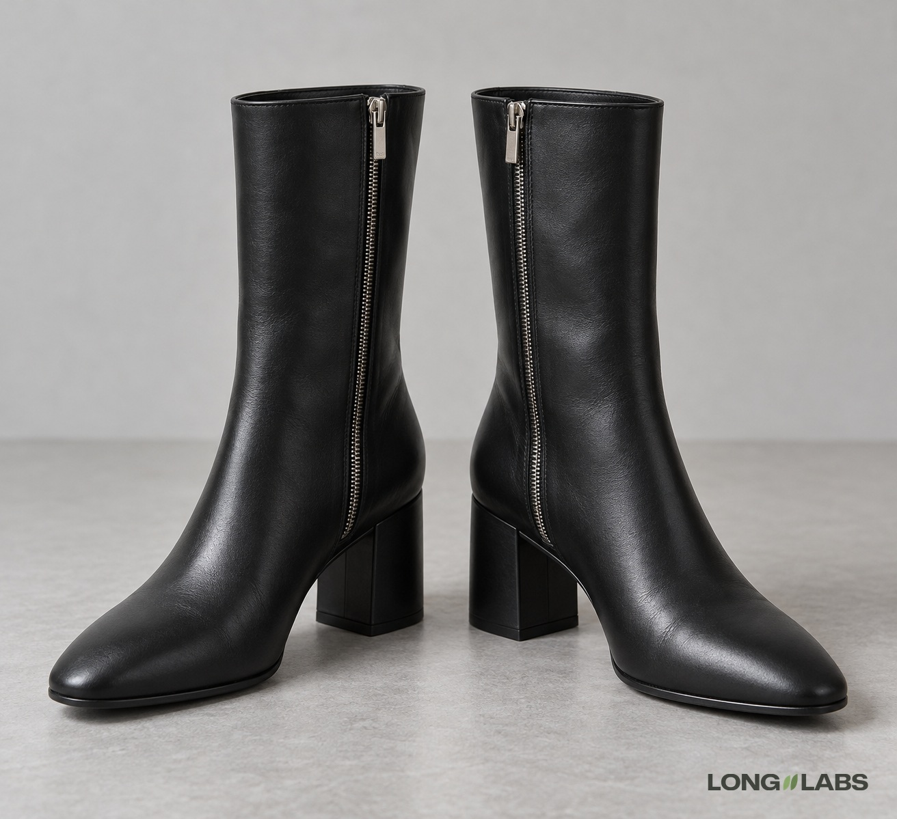

# Fashion boot



## Template

Attach photos of the real shoe from every side plus close-ups, then fill in the brackets.

```
The reference photos show the [boot] from every side plus close-ups of every detail. Copy it exactly, do not redesign:
1. Zip: [one or none], [metal colour], on the [inner, outer or back] side of each boot, running straight from the top of the shaft to [just above the heel]. The pull sits at [the top].
2. Seams: [one vertical seam down the centre of the back], from [the top] to [the heel]. [Other seams.]
3. Shaft: [ankle, mid-calf or knee height], [straight or slouch], the top edge [cut straight across].
4. Heel: [block, stiletto or flat], about [height] cm, [colour].
5. Toe: [almond, round, square or pointed], [no toe cap seam].
6. A left boot and a right boot, mirror images, each zip on its own [inner] side.
No buckles, no straps, no logos, no changed colours.
```

## Filled test version

An invented shoe, text only (no reference photos), so the first line becomes "A product photo of ...".

```
A product photo of a pair of black smooth leather mid-calf boots on a light grey floor in soft studio light. Both boots stand side by side facing the camera at a slight angle, so the inner side of each boot is visible. Copy this design exactly, do not redesign:
1. Zip: one silver metal zip on the inner side of each boot, running straight down from the top of the shaft to just above the heel. The pull sits at the top.
2. Back seam: one single vertical seam down the centre of the back of the shaft, from the top to the heel.
3. Shaft: a straight shaft ending at mid-calf, the top edge cut straight across, no slouch, no folds.
4. Heel: a black block heel about 6 cm high.
5. Toe: an almond toe, no toe cap seam.
6. A left boot and a right boot, mirror images, each zip on its own inner side.
No buckles, no straps, no logos, no changed colours.
```

## Test result

No fail on 2 of 2 images: the zip ran straight on the inner side of both boots, top to heel, with the pull at the top.
Not proven: the back seam was hidden at this angle on both. On image 1 the toe read closer to square than almond (unsure).
Ask for a back view as a second image to check the seam.

**Status:** No fail in 2 images, but the back seam was never visible at this angle.
