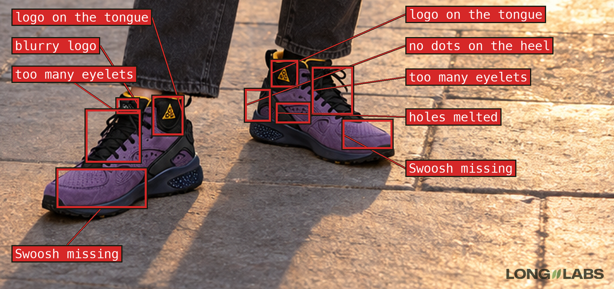
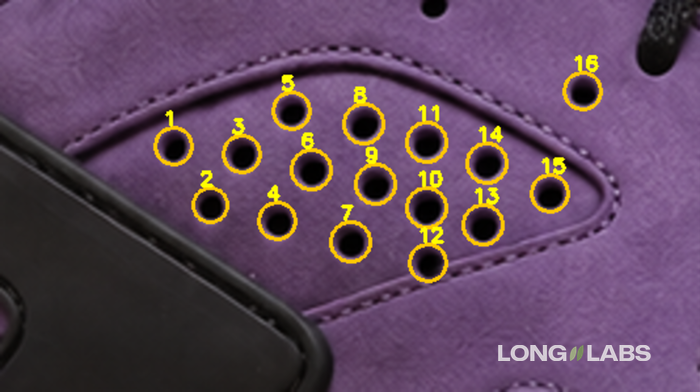
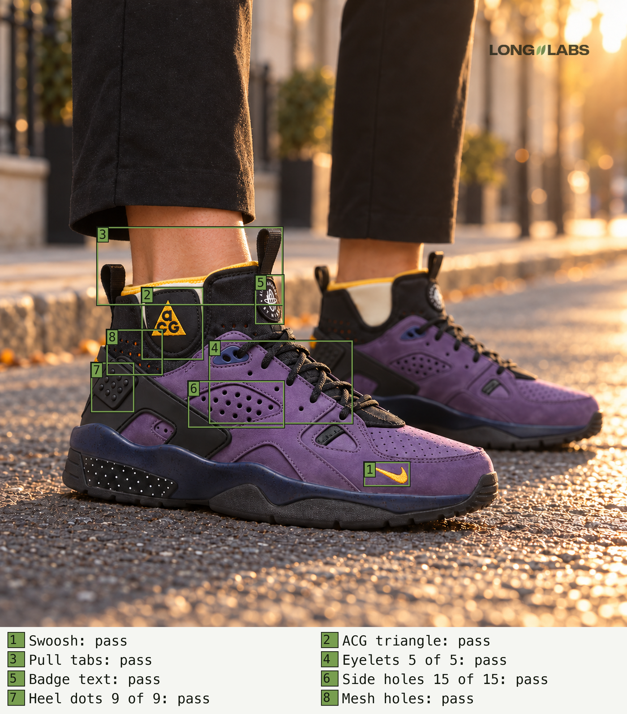

# shoe-check

Check an AI image of a real shoe against photos of the real shoe before it goes on your shop page or into an ad.
Six checks anyone can do by eye, the usual mistakes per shoe type, prompt snippets that fix what a prompt can fix and a copyable issue-finder prompt.

## How to use it

- **No setup:** open [SKILL.md](SKILL.md), attach your real photos and the AI image to any AI chat that reads images and paste the issue-finder prompt.
- **As a Claude skill:** add this folder to your Claude skills, then ask "check this AI shoe image against these photos".
- Not sure what to check on your shoe yet? Start with [shoe-painpoint-discovery](../shoe-painpoint-discovery/).

## What it catches

Our first AI try looked fine at full size. Up close: a logo on the tongue, the side logo missing on both shoes, holes melted and no dots on the heel.

Count one by one and never decide the number first. 15 holes in the panel in rows of 5, 6 and 4, plus one outside the panel that is correct.

After the fixes: every listed part passed, with the counts confirmed by eye.

## Tested

Tested on 8 AI images of one sneaker, 5 with one planted mistake each. The first version of the prompt flagged 3 of 5. The fixed version, run again on the 2 it had missed, flagged one of them as unsure. It never caught a removed heel dot.

by Long//Labs, [longlabs.tech](https://longlabs.tech)
